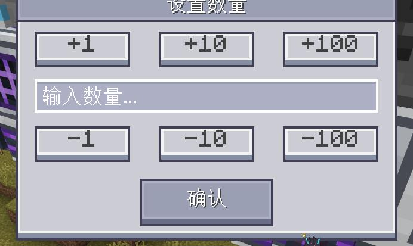
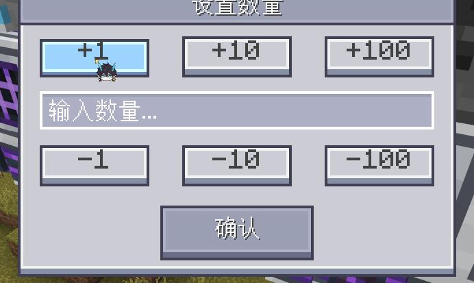
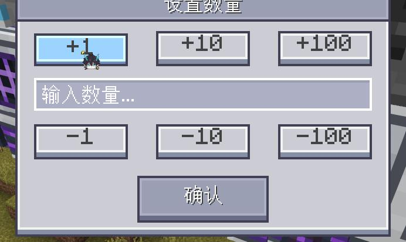
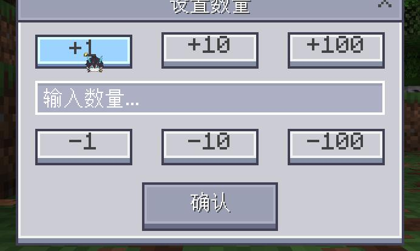
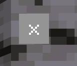
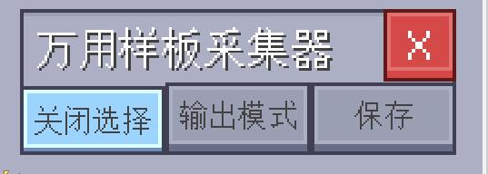

# 按钮按压反馈验收

日期：2026-11-10。参考 MoreEnoughItems 的 `mei_common.ore_style_button`。

## 实现约定

- 常规底板按钮复用 `endernet_ui_common.endernet_button`，内容由 `$button_content_control` 指定。
- 带固定角标的按钮使用 `endernet_badged_button` 与 `$button_badge_control`，显式声明三个共享状态和 `ok_img`；不在控件实例内使用 `modifications`。
- 内容路径为 `<default|hover|pressed>/wrapper/button_content/<icon|button_label>`；按用户最新确认，wrapper 的 Y 偏移依次为 -1、0、0，鼠标移入即下沉 1 像素，按住保持该位置，移出恢复；底板与点击区域固定。
- 所有叉号关闭按钮排除下沉：公共关闭面板三态固定 `(0,0)`；导入器红色 `x` 使用 `endernet_static_button`，覆盖 `$button_content_offset` 为 `(0,0)`，保留原有红色三态贴图和点击回调。
- 排序、筛选图标同步三态 UV；导入器文字同步三态标签，控件未就绪时重试。原版关闭模板保留关闭映射、尺寸、锚点与声音，叉号与固定底板分离。
- 导入器操作板的 `button.menu_select` 映射设置 `consume_event: false`，使子按钮能收到按下事件，同时保留标题区域拖动。
- 透明点击层、物品槽、背景热区、垃圾桶、两种样板模式图标和缓存滑动开关排除在本次改动之外。

## 离线验证

- `python -B endernet_tests/run_tests.py`：4703 项测试通过；168 个运行时文件通过 Python 2.7 语法门禁。
- 新增三态覆盖与排除项、导入器输入路由、动态内容同步、延迟挂载、排序缓存等回归；原有来源切换和按钮事件测试通过。
- 将排除控件与 Git 原版本逐项比较，结构与参数保持一致；`git diff --check` 通过。

## 游戏内验证

使用本地 3.10.0.448891 游戏（1.21.130），逻辑 UI 尺寸 480×253。PC 验证后，另通过 MCDK `buttons` 隔离会话加载最终资源；测试世界与原世界分开。

| 场景 | 实测结果 |
| --- | --- |
| 普通按钮最新 1px 验收 | 原生三态 Y 布局偏移为 `[-1,0,0]`，悬停及按下相对默认下降 1 像素；关闭按钮保持 `[0,0,0]` |
| 数量按钮初轮按压验收（旧 1.5px 参数） | 默认文字 Y=93，按下 Y=94.5；底板与点击区始终位于 (168,92.5)，尺寸 40×15 |
| OK 按钮初轮悬停验收（旧 1.5px 参数） | 同一实际控件默认文字 (290,112.5)，仅移入鼠标后 hover=true、文字 (290,114)，wrapper 为 (0,0.5)；底板仍位于 (286,111.5) |
| PC 连续点击与取消 | 四次有效释放对应四次回调；拖出取消不增加回调，文字恢复 Y=93 |
| 触屏输入模式模拟（初轮） | 确认 `INPUT_MODE=1`；旧参数下按住下沉 1.5 像素；三次有效点击对应三次回调，拖出取消后恢复 |
| 普通／紧凑关闭按钮 | 引擎识别为 Button，尺寸分别为 21×21、21×13；最终会话无新增 Unknown property 警告 |
| 关闭叉号最新排除验收 | 三类公共关闭按钮与导入器红色 `x` 的原生三态 Y 布局偏移均为 `[0,0,0]`；普通文字按钮为 `[-1,0,0]`。原版关闭映射保留 |
| 排序／筛选动态图标 | 真实客户端方法成功写入三个引擎状态控件，排序写成功后才缓存；筛选三态写入无错误 |
| 导入器动态文字 | 正式入口挂载成功；第一次按下就显示最新的“关闭选择”，释放只切换一次状态 |
| 导入器拖动 | 标题拖动后操作板从 (177,49.5) 移至 (192.75,56.75)，按钮状态不误切换 |
| 窗口重开 | 正式关闭并重开终端／导入器后，挂载完成，采样恢复未选择，标签为“开始选择”，默认 wrapper 偏移恢复 (0,-1) |

触屏结果来自 PC 引擎输入模式模拟，未在实体移动设备上测试。排序／筛选的完整设备交易仍由既有业务测试覆盖，本次游戏检查针对按钮视觉和内容写入。

首轮 19134 会话在热重载检查期间曾出现 IPC 超时；当时改用独立的 `buttons` 会话完成验收并结束测试进程。后续原会话已重新连通。

## UI 报错回归修复

用户报告实例内 `modifications` 未被当前网易引擎接受。现将状态面板提取为 `button_default`、`button_hover`、`button_pressed`，普通按钮与带角标按钮共同引用这些面板；万用导入角标改用独立内容模板显式实例化。

在用户当前打开的模板终端中保留界面重载，原生树确认 `universal_import_btn` 为 Button，其直接子控件为 `default`、`hover`、`pressed`、`ok_img`，三个文字路径均可访问。重新创建普通／紧凑关闭按钮也均为 Button，尺寸分别为 21×21、21×13，图标路径有效。日志游标 172 之后无新增 `Unknown property`、`Type not specified` 或旧关闭命名空间错误。

关闭按钮错误中的 `endernet_close_buttons` 属于首轮加载树／历史日志；当前登记的资源已无该命名空间引用，关闭模板统一位于 `endernet_ui_common`。新增合同测试禁止旧引用回流，并要求关闭入口显式声明 `type: button`；测试辅助解析器也已移除对实例 `modifications` 的模拟，避免离线误判。

## 关闭按钮排除修正

按用户最新要求，关闭按钮不参与悬停或按下位移。移除三类公共关闭模板的九处状态位移参数，公共叉号面板直接固定 `(0,0)`；另排除导入器红色 `x`。回归遍历所有 `close`／`compact_close` 实例，明确覆盖 `bus_template_io.json` 的总线样板接口和 `template_terminal_panel.json` 的样板终端，三态均为零位移。

游戏重载后，通过原生 `GetFullPosition("y")` 读取三类关闭模板与导入器红 `x` 的布局，default／hover／pressed 的 `absoluteValue` 全部为 0；普通按钮的最新对照值为 -1／0／0，即相对下沉 1px。临时检查控件隐藏创建并即时移除，未触发关闭动作。

## 提交前全面复核

- 遍历全部 26 个 UI 文件并核对登记表，没有未登记的遗漏文件。
- 独立于测试的纹理前缀过滤，解析全部按钮继承与内容固有偏移：48 个普通按钮声明（44 实例、4 公共模板）均为 `[-1,0,0]`；40 个关闭按钮声明（35 实例、5 模板）均为 `[0,0,0]`。
- 44 个辅助／槽位／透明点击／背景／模式图标声明、3 个抽象按钮模板及缓存滑动开关逐项分类，沿用已确认的排除范围。设置图标固有 Y=1、部分文字固有 Y=-1 在三态一致，不额外叠加位移。
- 回归扫描改为使用继承后的有效按钮类型和纹理，明确要求通用／合成／样板三类终端的 6 个排序实例进入三态偏移检查。
- 原生引擎内隐藏创建 13 个公共模板及退出按钮检查控件，逐一读取三态 Y 布局参数：普通按钮为 `[-1,0,0]`，关闭按钮为 `[0,0,0]`，全部符合；检查后立即移除。
- 运行时代码复审确认没有生产调用 `SetOreUiButtonCallback`，不会与 JSON 位移重复叠加。动态图标、文字同步及延迟挂载重试保持有效。
- 完整门禁 4703 项通过，168 个运行时文件通过 Python 2.7 语法检查；31 个生成方块及资源映射检查通过，`git diff --check` 通过。

## 截图

以下为初轮按压验收截图，早于用户后续确认的“仅悬停即下沉”及“关闭按钮不下沉”调整；最新结果以上方坐标和布局实测为准。

| PC 默认 | PC 悬停 | PC 按下 |
| --- | --- | --- |
|  |  |  |

触屏模拟按下：

关闭叉号与导入器最新文字：

