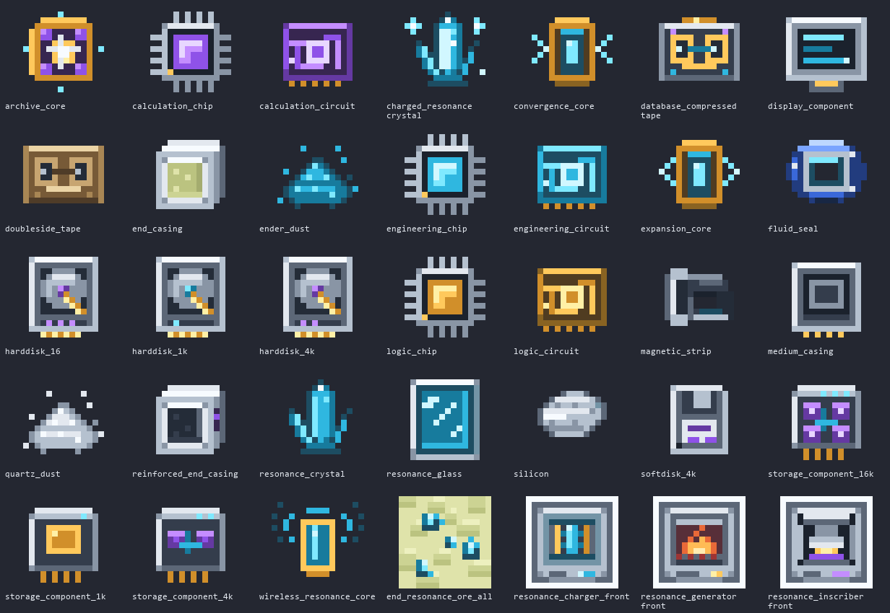
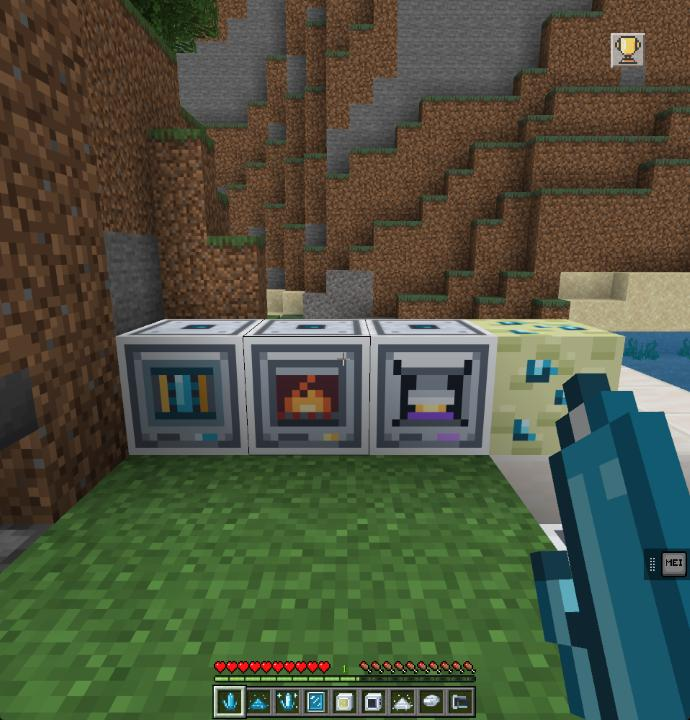
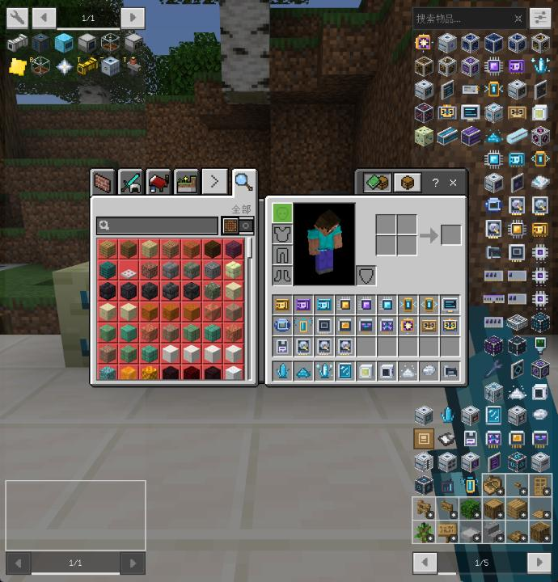

# 材料、配方与独立机器验收

2026-11-15，依据 [materials.md](../../materials.md) 实施。材料绘制、注册、原生配方、末地矿石及三台独立机器已落地；本目录区分离线门禁与真实引擎结果。

本目录截图保留为材料实施初版的历史记录。后续两台机器 UI 已按 SkyBlueTech 的 `ThermalGeneratorUI` / `ChargerUI` 迁移：发电机采用燃烧火焰、能量条和状态灯，充能器采用能量条、状态灯、闪电进度及 26 px 成品输出槽；压印机保留原界面。当前实现与实机证据见 [生产设备 UI 验收](../production-ui/README.md)。

## 交付内容

- 25 种材料；补齐其余 6 种存储介质的物品注册及贴图，现有 8 种介质均可制作。
- 31 张物品图标、矿石贴图及 3 张机器正面贴图，均为 16×16；机器其它面延续已有白色机壳。
- 72 条工作台配方、2 条原版熔炉配方、8 条机器加工配方。
- 谐振充能器、谐振压印机、谐振燃料发电机及各自原生容器界面。通过现有 transferlib/radium 能源接口供电，不占仓储网络带宽。
- 末地谐振矿石的自然生成、工具等级、普通掉落、精准采集与熔炼。

资产由 `scripts/gen_blocks.py`、`gen_items.py`、`gen_materials.py`、`gen_material_textures.py` 和 `gen_production_ui.py` 生成；材料及配方数据源为 `common/materials.py`，由 `common/definitions.py` 汇入注册清单。

## 离线检查

[完整记录](offline-checks.txt)：4918 项测试全部通过，188 个运行时文件通过 Python 2.7 兼容性检查，五项生成器 `--check` 均通过。新增回归覆盖加工守恒、日志写入失败、存档恢复、UI 绑定、配方覆盖及矿石资产约束。

## 实机结果

使用 `D:/ai/mcdk-assistant-win-x64/mcdk.exe` 启动后台隔离会话，未使用用户日常存档。测试原料由 SDK 建立；加工、熔炼、漏斗传输、采掘及区块生成均由真实引擎执行，没有手动调用机器 `tick()` 冒充游戏验证。

| 检查 | 实测结果 | 证据 |
| --- | --- | --- |
| 物品和原生配方注册 | 37 个目标 ID 全部识别，72 个工作台产物均有配方 | [注册](registration.json) |
| 工作台配方内容 | 72/72 条原生输入数量、元数据和产出与设计一致；木板标签按原生可选木板展开 | [逐条核对](recipe_inputs_audit_result.json) |
| 机器加工 | 充能、磨粉、三种压印、三种封装全部正确扣料并产出，成品无重复，服务无错误 | [8 种配方](machine-recipes.json) |
| 加工日志持久化 | 八台机器均捕获到写入原生方块实体的 JSON 日志字符串，回读与写入一致 | [同上](machine-recipes.json) |
| 满输出与满能源缓存 | 输出已满时原料、成品和 FE 不变；发电机缓存满后燃烧剩余刻数不变 | [暂停](machine-output-full.json) |
| 原版漏斗 | 电路、硅片、红石仅投入漏斗，自动进入三个固定输入槽，产出工程芯片×1 | [漏斗封装](machine-hopper.json) |
| 跨存档恢复 | 640 FE 加工到 20/80 刻后断电；退出重进保留原料和进度，补 1920 FE 后产出恰好 1 个充能水晶 | [重载](machine-reload.json) |
| 原生 UI | 三个界面均打开并显示服务器能源数据；鼠标切压印模式成功，成品可移入玩家背包 | [UI 与熔炉](ui-and-furnaces.json)、下方截图 |
| 原版熔炉 | 原版漏斗投料、燃料并收集输出：石英粉→硅片×1，矿石→水晶×1 | [熔炼](ui-and-furnaces.json) |
| 矿石掉落 | 普通铁镐得水晶×1，精准铁镐得矿石×1，石镐无掉落；原版钻石矿作对照 | [采掘](ore-drop-results.json) |
| 自然生成 | 无限世界 64 个事先未生成的末地区块，共 956 块矿石；主岛和外岛均有，未调用手动放置特征接口 | [区块记录](worldgen_infinite_result.json) |

自然生成会话为 `materials-worldgen-20261115`，`world_type=1`、种子 `20261115`；另外的 `materials-20261115` 会话负责容器、配方、UI 和存档测试。两份隔离存档保留在 `.mcdev/lanes/`，原始调试中间文件归档在 `.mcdev/materials-debug/`。

初版历史界面截图：[充能器](charger-ui.jpg)、[压印机](inscriber-ui.jpg)、[发电机](generator-ui.jpg)。

## 本轮发现并修复的问题

- ToolDelta 静态监听注册不接受绑定方法，改用明确的函数包装。
- 原生物品回读会补全空元数据字段，改用规范资源身份和数量比较，避免错误恢复或重复产出。
- 原生方块实体不能保存包含字典和 `None` 的混合列表；加工日志改用 ASCII JSON 字符串，保留原样回读校验，恢复修改槽位前必须先成功保存日志。旧日志格式可读，恢复后清除过期提示。诊断见 [日志写入失败](machine-persistence-mismatch.json)；[修复前加工记录](machine-recipes-before-fix.json) 仅保留作为失败证据，不是最终通过结果。
- 界面标签需引用 `#text` 才能显示动态绑定，修正了只显示静态初始提示的问题。
- 特征文件名需匹配标识符尾部，格式版本统一为网易支持的 `1.14.0`；旧有限世界不能作为无限世界自然生成验收。见 [生成诊断](worldgen-diagnostic.json)。
- 箱子原料按原版配方省略辅助值；染料使用本版本原生归一化结果核对。
- 网易引擎自行处理精准采集及工具等级，矿石战利品表只声明普通水晶掉落，移除了排除普通工具的附魔条件。见 [掉落诊断](ore-drop-diagnosis.json)。

## 验收范围

本轮验证材料生产、原生配方注册及上述独立机器流程。没有把完整仓储开局、样板订单产线、触屏操作或多玩家联机宣称为已经验收；现有网络容量、耗能缺项和流体能力仍遵循原规格。矿石只保证在无限世界新生成的末地区块生效，不补写旧区块，不保证旧有限地图或超平坦；时运当前不增加产量。
