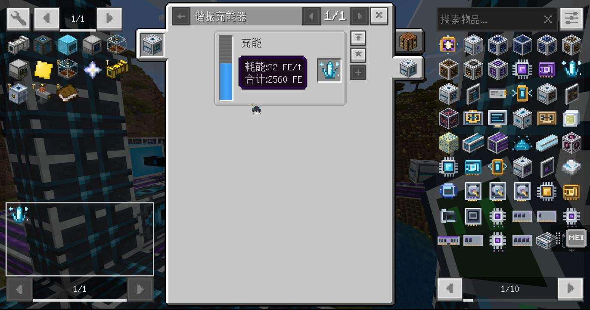
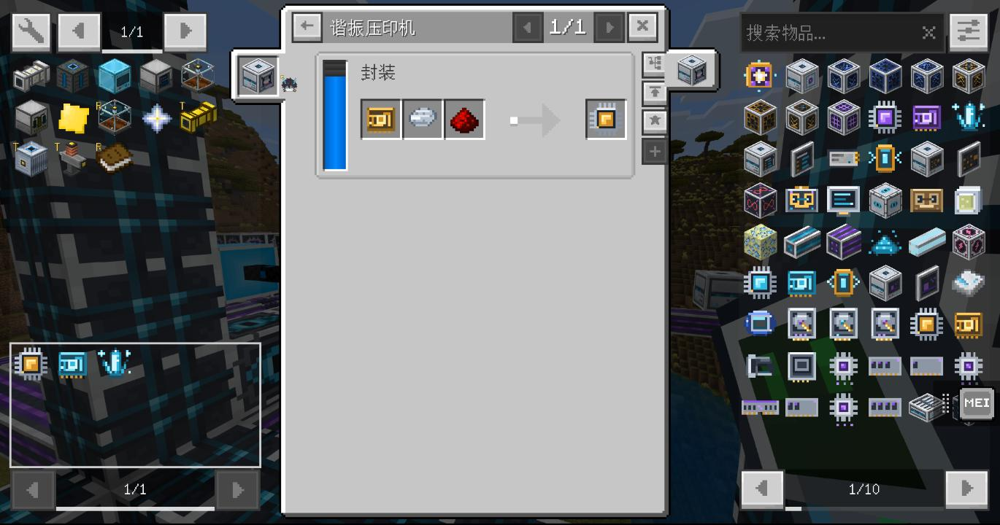
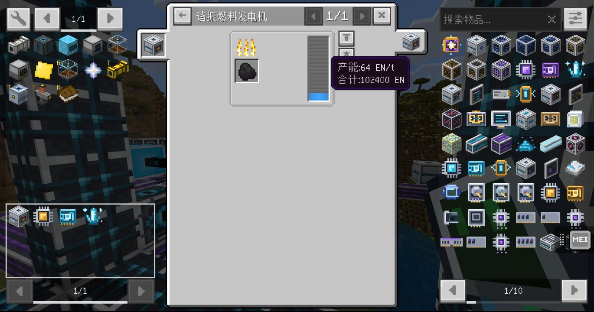

# MEI 机器配方查询验收

2026-11-15。使用工作区 `D:/addon/MoreEnoughItems` 的公开扩展 API v2，通过客户端 `MoreEnoughItems:MeiApi` 组件接入。运行时代码不直接导入 MEI；未安装 MEI 时跳过注册。

## 适配范围

| 机器 | 查询内容 | 显示信息 |
| --- | --- | --- |
| 谐振充能器 | 1 条充能配方 | 输入、输出、4 秒、32 FE/t、总耗能 2560 FE |
| 谐振压印机 | 7 条粉碎、压印、封装配方 | 原料数量、产量、工作模式、耗时及耗能 |
| 谐振燃料发电机 | 1 条可选煤炭／木炭的发电配方 | 每件燃料 80 秒、64 FE/t、总发电 102400 FE |

加工配方直接读取 `common/materials.py`。发电速率、燃烧刻数和可接受燃料也由该模块统一提供给服务端及 MEI；能源以能量条与悬停提示显示，不伪造可查询的物品产出。查机器本身的用途可列出该机器全部配方。压印机与充能台页面现已开放加号导入样板终端，详见下方配方转移验收；发电燃料页保持隐藏加号。

配方脚本支持 MEI 的预览布局，所有槽位沿用 MEI 的 20×20 控件。空槽由外层面板隐藏，避免槽位自己的可见性绑定覆盖隐藏状态。

## MEI 贴图与独立能量控件（2026-11-15）

配方页已移除 `SkybluePanelLib`、`MachineRecipeLib` 和
`textures/ui/skybluetech/` 的外部引用。公共显示控件位于
`ui/endernet/mei_recipes/common.json`，能量控件单独放在同目录 `energy.json`。

- 背景与 MEI 内置配方页一致，使用 `textures/ui/mei/recipe/recipe_bg` 及 3 px 九宫格边距。
- 加工箭头使用 MEI 熔炉页相同的原版 `arrow_inactive` / `arrow_active`，尺寸 24×17；火焰使用 `flame_empty_image` / `flame_full_image`，尺寸 15×15。裁剪比例由原有 Python 脚本更新，JSON 不设字面 `clip_ratio`。
- 能量条为本地 `EnderNetMeiEnergy.energy_meter`，轨道、渐变填充和边框均取本资源包已经携带的 `textures/endernet/ui/production/skybluetech/` 资源，许可见 [SkyBlueTech MIT 说明](../../../third_party/skybluetech-ui-LICENSE.txt)。目录中的来源名称不代表运行时依赖。
- 发电页显式定义 85×62 内容区、20×20 燃料槽和右侧 18×54 能量条；充能页保持 108×62，压印页保持 154×62，两者左侧能量条为 12×54。三类布局及 tooltip 配方预览共用相同本地控件，保留脚本依赖的槽位和动画路径。
- 能量条保留 17 段量化、悬停信息和原有动画方向；发电显示 EN，耗电显示 FE。动画继续由 MEI 的统一 `OnAnimTick` 驱动，预览最长循环 20 秒，燃料实际 80 秒由提示如实显示。

UI 的第三方控件引用仅保留 MEI 自身公开的 `mei_common` / `mei_recipe_common`；MEI 缺席时仍由原有组件探测跳过扩展注册。离线回归检查全资源包命名空间闭包、外部贴图残留，以及三类配方页实际继承展开后的能量遮罩、进度遮罩、MEI 悬停层和燃料槽。

本轮实机和全量门禁基于包含其他未提交改动的当前工作区，其中发电单位改为 EN 的调整不属于本次 UI 去依赖改动。

本轮验证：

- 全量 `run_tests.py`：**4997 项全部通过**，190 个运行时文件通过 Python 2.7 语法门禁；新增 3 项依赖与真实控件路径回归。`gen_blocks.py --check`（39 个方块）及 `gen_production_ui.py --check` 均通过。
- 提交前单独导出本次暂存版本，排除其他工作区改动后，**4989 项全部通过**，190 个运行时文件通过 Python 2.7 语法门禁。
- 离线渲染只加载 EnderNet、MEI 和原版资源，不加载 SkyBlueTech，配方背景、能量条、箭头及火焰可解析并绘制。
- 完整重进后，充能／压印／发电三个类别自动注册，配方数仍为 1／7／1。实机检查充能页、压印页的三原料封装配方，以及发电页；图标、背景、箭头、火焰和能量条正常。
- 运行时能量填充高度：加工页循环起点／终点／复位为 51／0／51 px，发电页为 0／51／0 px；箭头为 24×17，火焰为 15×15。真实鼠标悬停可见充能耗能 32 FE/t、合计 2560 FE，以及发电产能 64 EN/t、合计 102400 EN。
- 完整重进后的本轮页面检查没有新增错误日志。此前只做原生 UI 热重载时，MEI 留有旧界面引用并报空控件错误；完整重进后不再复现。

本次实机仍同时加载 SkyBlueTech；未验证卸载 SkyBlueTech 后的完整游戏启动，去依赖由离线引用检查与不加载该包的渲染验证。触屏和 tooltip 配方预览未进行本轮实机操作；preview 的本地继承与自包含性已静态复核。

## 离线结果

- `python -B endernet_tests/run_tests.py`：190 个文件通过 Python 2.7 兼容性门禁；4935 项测试中 4934 项通过，1 项失败。
- 唯一失败为已有的 `test_assets.TestResourcePackMapping.test_no_unreferenced_device_textures`：工作区未跟踪文件 `endernet_rp/textures/endernet/devices/bus_item_input_io_top.png` 未被引用。本次保留该文件，未放宽资产检查。
- 新增 10 项 MEI 回归均通过，覆盖配方数量、原料与产量、燃料 aux、缺失物品、软依赖、注册时机、卸载与重复进世界，以及可见性外层面板。
- `test_production*.py`：31 项通过。
- `scripts/gen_blocks.py --check` 与 `scripts/gen_materials.py --check` 通过，生成资产无需更新。

## 实机结果

通过工作区 MCDK 连接在实际游戏中验证，并在完整重载后复查：

- 扩展 `endernet:production` 自动注册，与原版和 SkyBlueTech 扩展共存。
- 三个类别的完整配方数为 1／7／1；八条加工配方均可按产物查到，模式及数值与源数据相同。
- 查三台机器的用途分别返回 1／7／1 条；查硅片用途返回三条芯片封装配方。
- `minecraft:coal` aux 0、aux 1 和 `minecraft:charcoal` aux 0 均命中发电用途；煤炭 aux 2 不命中。
- 三类页面实机可见，输入、输出和中文说明正常；充能页及发电页的多余槽位保持隐藏，重进后配方无重复或丢失。最终三页复查期间无新增错误日志。

[实机查询结果](query_result.json)；[可重复运行的客户端查询探针](query_probe.py)。探针为了验收直接访问 MEI 上下文，产品代码只使用组件提供的扩展生命周期上下文。

热重载验证期间曾出现旧终端界面及 MEI UI 生命周期错误；完整重进后不再复现。未实测触屏交互、快捷填料与缺席 MEI 的完整启动；其中软依赖由离线测试覆盖。

## 样板终端配方转移（2026-11-15）

通过公开 `ctx.UI.Screens.Register` 挂载 `endernet_template_terminal_panel.main`，
避让／隐藏 `/window`，使用 `ctx.UI.Transfers.Register` 注册两个不消耗物品的处理器：
工作台类别 `crafting_table` 使用 `GRID=(3,3)`；其他类别使用 `GRID=None`，避免 MEI
把机器原料的数量拆成多个输入格。转移操作发送 EnderNet 自己的 `template_mei_import`，
由服务端原子校验并应用。完整规则见 [样板终端契约](../../ui/template_terminal_panel.md)。

离线结果：`python -B endernet_tests/run_tests.py` 全部 **4967 项通过**，190 个运行时
文件通过 Python 2.7 语法门禁；`python -B scripts/gen_blocks.py --check` 通过（39 个方块）。
本轮新增 26 项回归：MEI 接入 10 项、客户端提交／回执 6 项、服务端导入 10 项。
覆盖可选接口、注册／卸载所有权、关闭重开、缓存检查与在途请求、候选 aux 与九宫格
摆位、机器大数量及多产物、容量超限拒绝、失败原子性、修订冲突、服务端合成产物复核
和样板编码。未将概率、催化剂或非物品配方悄悄转成普通配方。

MCDK 当前 PC 测试世界实测设备为 `(dimension=0,x=-4,y=87,z=-10,slot=north,generation=0)`：

| 操作 | 观察到的客户端／服务端结果 |
| --- | --- |
| 从工厂模式打开木棍工作台配方，实际鼠标点击第一条配方的「+」 | 成功回执；修订 31→32；自动改为 `crafting`；输入格 0、3 各一个 `minecraft:acacia_planks`；中间预览 4 根木棍 |
| 从合成模式打开石英粉碎配方，实际鼠标点击「+」 | 成功回执；修订 32→33；自动改为 `factory`；格 0 一个 `minecraft:quartz`；首输出格 2 个 `endernet:quartz_dust`；原九宫格余格清空 |
| 再次点击木棍配方「+」 | 成功回执；修订 33→34；切回 `crafting`，标题、输出框位置与四根木棍预览同步 |
| 关闭终端 | 活跃 MEI 编辑器引用清空，旧 `TemplateView.closed=True` |
| 验收后恢复 | 配置恢复测试前的空工厂模式；真实输入／输出槽与测试前逐项相同，修订继续递增到 35 |
| 再次重进世界 | 未手动调用注册；MEI 已就绪、`endernet:production` 扩展已装配，样板终端代理自动注册；重新打开原终端 |

截图：[合成样板导入](template_crafting_import.jpg) · [工厂样板导入](template_factory_import.jpg)。
实测从配方页点击加号到服务端回执及状态投影的完整链路；没有点击编码按钮，未生成
样板物品。最终测试会话没有新增 Python／MEI 错误日志；早期脚本热重载时的旧界面
tick 错误在退出并重新进入后停止。

尚未实测真实手机触控、其他模组全部配方种类，以及 MEI 缺席时的完整游戏启动；
这些边界的离线拒绝／软依赖行为已覆盖。工厂导入仅保存输入和产物，机器模式与
能耗仍由机器本身的规则处理。

## 无序工作台配方修正（2026-11-15）

用户反馈无序配方被拒为「服务端工作台配方与 MEI 不一致」。排查确认两处共同原因：
服务端把引擎返回的无序原料 `count` 误读为单格堆叠数量；无序原料的 `item` 为标签
展开候选列表时，又被当成非法格式而整条跳过。游戏中的单面／双面胶带均包含任意
木板候选，书本包含 `paper,count=3`，因此此前的有序配方验收未覆盖这两类问题。

现统一按数量展开无序原料槽位，每格消费一个；保留每组候选与 aux，使用一对一
匹配处理候选重叠。MEI 导入、终端自动预览、原有按产物导入和补料共用正确语义。
普通配方的原始条目与已有 digest 保持不变；超过九格、缺料、多余格或错误产物仍
拒绝，不放宽服务端一致性校验。历史交付记录中「三张纸堆一格」的说明由此更正为
三格纸加一格皮革。

最终离线门禁：**4985 项全部通过**、190 个运行时文件通过 Python 2.7 语法检查，
39 个方块的生成资源检查通过。新增覆盖无序数量展开、木板候选、候选重叠、通配
aux、超容量拒绝，以及导入后预览／编码；旧单物品配方 digest 的固定回归通过。

完整重进游戏后，在当前样板终端 `(0,-13,86,-10,generation=0)` 实际点击 MEI「+」：

- 书本：修订 375→376，三个纸分别占 0／1／2 格，皮革占 3 格，预览一个书本，成功回执。
- 双面胶带：修订 376→377，两个磁条分别占 0／1 格，铁锭与选中的金合欢木板占
  2／3 格，预览一个双面胶带，成功回执。
- 测后恢复原来的空合成配置，修订递增至 378；57 个空白样板及真实输出槽与测试前
  完全相同。未执行编码，未生成或消耗物品；本轮实测没有新增 Python 错误日志。

截图：[无序书本](template_shapeless_book.jpg) · [含木板候选的双面胶带](template_shapeless_tape.jpg)。

