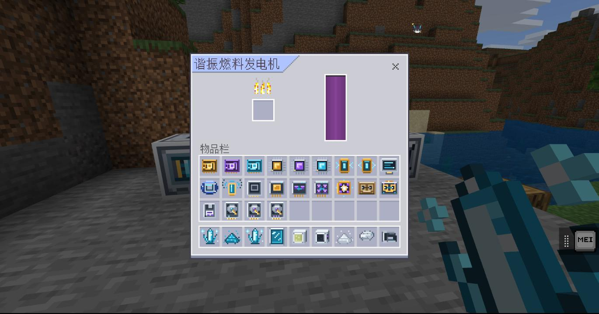
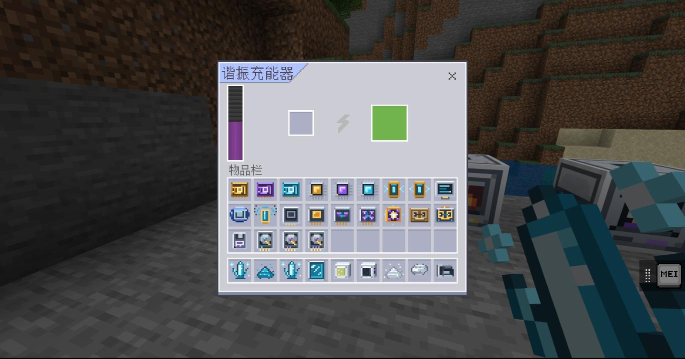
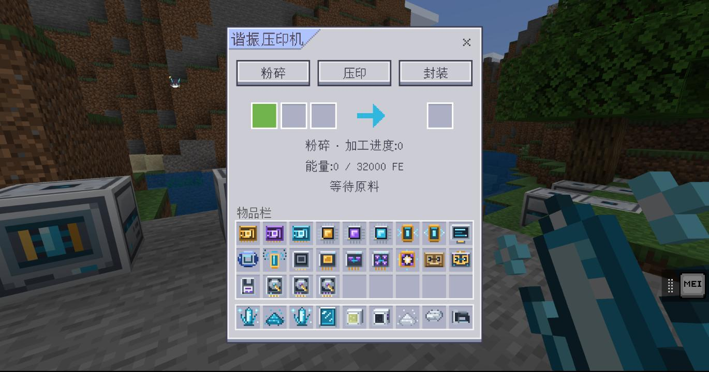

# 谐振机器界面迁移验收

日期：2026-11-15。按当前工作区的 SkyBlueTech `ThermalGeneratorUI` 和 `ChargerUI` 移植布局、能量条与界面反馈，接入 EnderNet 原有机器快照和原生容器。最终常态能量条使用紫色渐变，充能器低于 15% / 5% 时分别显示黄 / 红色；发电机不使用低电告警。

## 最终界面

### 压印机仪表与紧凑槽位（2026-11-15）

压印机移除常驻能量数值和加工百分比文字，改用充能器同款 12×54 px 紫色能量条及 SkyBlueTech 原始 `progress/arrow_bg.png`、`arrow_fill.png` 的 22×15 px 箭头。箭头由左向右填充，缺电暂停时保留服务器进度。能量数值保留在鼠标悬停／按下提示中，低于 15%／5% 时沿用黄／红告警。

三个输入槽按 18 px 步距紧挨排列，输出槽仍在箭头右侧，原生槽索引 0～3 不变。保留模式按钮、服务器状态提示和常显白框，新增能量条白框；面板从 174×216 调整为 176×196 px。模式按钮选中状态与仪表在同一轮快照刷新。

离线验证：4925 项测试、189 文件 Python 2.7 兼容检查通过，记录见 [inscriber-gauges-offline-checks.txt](inscriber-gauges-offline-checks.txt)；生产 UI 与方块生成器 `--check` 通过。新增回归覆盖箭头空／部分／满／复位及缺电暂停保留进度。已重载游戏 Python 和原生 UI 定义，但本轮尚未完成压印机实机视觉、取放物品及模式切换验收；下方截图均为改动前历史记录。

### 之前的界面验收记录

压印机模式按钮现按服务器快照互斥选中：当前模式在松手和移开鼠标后继续显示按下贴图。复用 `endernet_ui_common` 的按钮内容控件，普通/悬停文字偏移 `[0,-1]`，按下/选中文字偏移 `[0,0]`，与其他设备一致。实机依次验证了[粉碎](mode-grind.jpg)、[压印](mode-press.jpg)、[封装](mode-assemble.jpg)；后两种状态的原生控件树见 [压印](mode-press-tree.json)、[封装](mode-assemble-tree.json)。4924 项测试及 189 文件兼容门禁通过，见 [模式按钮检查](mode-buttons-offline-checks.txt)。

背景与槽位采用装配仓的 EnderNet 样式：使用同一面板底图和槽位底图，26 px 成品槽通过局部背景模板适配尺寸；未修改公共容器模板，也未引入装配仓的 `stat_bar` 网络状态条。紫色能量条、火焰和闪电进度保留。

三台机器统一采用用户在充能器中修改的 `main/title/title_text`：标题底板、字体、字色、偏移保持一致，充能器与压印机为 64×16 px，发电机长标题为 88×16 px。旧标题状态灯与其控制代码已移除。所有 ring 均为白色、常显、alpha=1，取消变色、显隐与闪烁动画；充能器 3 个、发电机 2 个、压印机 4 个，共 9 个框。

本轮实机逐一打开三屏，原生控件树确认全部标题与 9 个框可见：[充能器](title-frame-charger-tree.json)、[发电机](title-frame-generator-tree.json)、[压印机](title-frame-inscriber-tree.json)。充能器用 640 FE 加工到 20/80 刻后进入缺电状态，三个框仍常显白色，能量告警提示保持正常：[状态](title-frame-charger-paused-state.json)、[控件树](title-frame-charger-paused-tree.json)、[截图](charger-title-frame-paused.jpg)。运行错误流无新增记录，见 [本轮日志](title-frame-runtime-errors.json)。完整门禁为 4924 项测试通过、189 个源码文件通过 Python 2.7 检查、五个生成器检查通过，见 [本轮离线检查](title-frame-offline-checks.txt)。

上一轮背景与槽位风格调整已实机检查能量提示，并通过鼠标从 26 px 成品槽取出充能水晶；[库存回读](assembly-style-inventory-state.json) 确认成品槽清空且快捷栏得到 1 个物品。[上一轮离线检查](assembly-style-offline-checks.txt) 保留为历史记录。

- 燃料发电机：18 px 燃料槽、13 px 火焰、18×54 px 储能条。火焰按剩余燃烧刻数 / 总燃烧刻数裁切。
- 充能器：18 px 输入槽、26 px 输出槽、9×14 px 闪电进度、12×54 px 储能条。
- 共同反馈：储能 / 容量悬停提示；边框始终保持白色。能量填充沿用前置的量化显示逻辑；内部 52 px 满量为 51 px，17 档，非零电量至少显示一档。
- 提示同时设置鼠标悬停和按下状态的文本；本次实机验证为 PC 鼠标，未将触屏操作记为已验收。

## 原仪表迁移的实机记录

下表保留迁移初期的行为验证，其中状态灯与动态提示环已被本轮统一标题和静态白框替代。

使用隔离会话 `materials-20261115`，有限测试世界种子 `20261115`；充能器 `(55,64,34)`，发电机 `(57,64,34)`。投料和取出均通过原生界面鼠标操作；能量与初始燃烧余量由测试脚本设置，未替换机器的实际加工逻辑。

| 场景 | 观察结果 | 证据 |
| --- | --- | --- |
| 充能器低电 | 640 / 32000 FE 显示红色填充，悬停显示实际储能和电量告急 | [截图](charger-energy-tooltip.jpg) |
| 充能中途缺电 | 投入一个水晶，640 FE 耗尽后停在 20 / 80 刻，闪电 25%，红色状态灯与储能提示环 | [快照](charger-paused-state.json)、[截图](charger-paused.jpg) |
| 恢复供电 | 补 1920 FE 后完成剩余加工，输出一个充能水晶 | [快照](charger-finished-state.json)、[截图](charger-finished.jpg) |
| 放大成品槽取物 | 鼠标从 26 px 输出槽取出，实际机器输入、输出均为空，玩家快捷栏得到充能水晶×1 | [库存回读](charger-inventory-state.json) |
| 发电机缓存满 | 32000 FE，剩余燃烧 800 / 1600，火焰 50%，待机灯与储能提示环 | [快照](generator-full-state.json) |
| 发电机空燃料 | 0 FE、0 燃烧余量，提示燃料槽，未使用充能器的红色低电告警 | [快照](generator-empty-state.json) |
| 真实燃料燃烧 | 鼠标投入煤后显示工作状态，快照记录 7808 FE、燃烧余量 1478 / 1600，燃料提示环关闭 | [快照](generator-working-state.json) |

`generator-full.jpg`、`generator-working.jpg` 保留颜色调整前的行为验证截图；`*-purple.jpg` 和 `*-assembly-style.jpg` 保留后续两轮外观。当前外观以上方 `*-title-frame.jpg` 为准。原仪表验证区间未新增运行错误，见 [日志游标](runtime-errors.json)。

## 离线检查与来源

初次迁移的完整测试、Python 2.7 兼容检查和五个生成器检查见 [offline-checks.txt](offline-checks.txt)，最新压印机检查见本页开头。压印机保留三种模式，进度与能量现已采用仪表显示。

源参考为 SkyBlueTech `resource_pack/ui/ThermalGeneratorUI.json`、`ChargerUI.json`、`SkybluePanelLib.json` 及客户端 `machinery/utils.py`、`define.py`。所用纹理复制到 EnderNet 独立资源路径，共用控件使用 `endernet_production_common` 命名空间。紫色采用前置已有的 rose 渐变纹理配合界面 tint，黄 / 红告警恢复原色。版权与 MIT 许可见 [skybluetech-ui-LICENSE.txt](../../../third_party/skybluetech-ui-LICENSE.txt)。
