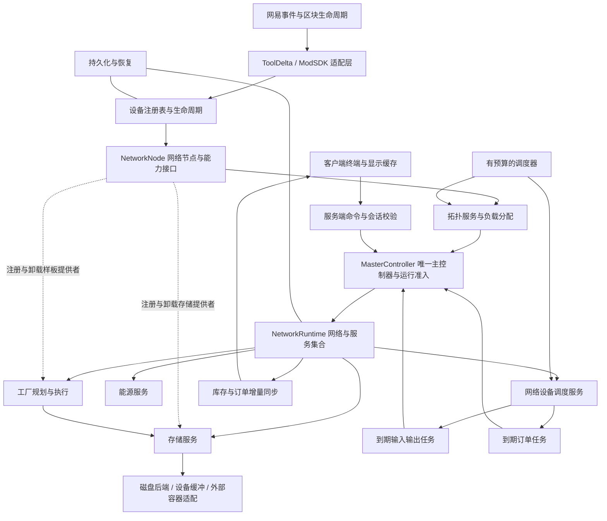

# EnderNet 架构规划

更新日期：2026-09-28。本文以 Applied Energistics 2（AE2）为唯一外部模组架构参考，结合 `plans/` 的玩法规划和本项目的网易运行环境设计；未确定的规则在下文明确标出。**进度状态不在本文维护**，一律以 [00 任务总览](<./tasks/00. 开发流程与任务总览.md>) 的「当前进度」与各任务交付说明为准。

分系统的实施任务、依赖、交付接口与验收清单见 [开发流程与任务总览](<./tasks/00. 开发流程与任务总览.md>)。

## 1. 结论

采用 **服务端权威、以网络为业务边界的模块化单体架构**：用网络图管理连接关系，每个网络持有存储、能源、工厂和调度服务，设备通过网络节点提供能力接口，用事件与有预算的调度器驱动运行。

**每个网络图最多接入 1 个控制器，可工作的网络必须恰好具有这 1 个控制器。** 它是唯一的 `master controller`，统一控制输入口收货、取货口供货和订单执行；网络服务是主控制器调用的业务模块。不同独立网络分别拥有自己的主控制器，同一网络不设置共同控制或备用控制器。

“控制器”的判定范围是 [blocks.md](./blocks.md) 中“网络控制器”分组下的全部方块类型，当前包括 `endernet:dos_network_endpoint`、`endernet:tiny_network_endpoint`。限制按这些类型的方块实例合计计算；后续增加控制器型号时，不会获得额外的同网接入名额。各型号允许的设备和功能仍须按方块规划校验，拥有主控不等于支持全部功能。

核心关系对应 AE2 的 `Grid`、`GridNode`、网络服务和节点服务接口。使用普通 Python 对象封装设备与业务状态，用字典维护位置、资源和提供者索引。跨设备的库存、负载和订单规则集中在所属网络的服务中处理。

## 2. 依据与当前状态

玩法依据为当前 `plans/` 的四份规划：

- [concepts.md](./concepts.md)：网络、网络负载、单位物、订单、样板与回流完成条件。
- [blocks.md](./blocks.md)：控制器、不同容量基带、各类总线、存储驱动器、终端、并行处理器及其连接器、内存槽、装配仓和能源入口。
- [items.md](./items.md)：介质的类型数、总容量、独立读写速率，以及两类样板。
- [demo.md](./demo.md)：简易仓储、自动存取和订单系统的连接示例。

仓库现状见 [00 任务总览](<./tasks/00. 开发流程与任务总览.md>) 的「当前进度」——那里逐任务维护，本文不复制一份（原先此处停记于 2026-09-24，只写到 01/02，早已过时）。同级 ToolDelta 子模块提供端侧注册、事件、容器与 UI 绑定等封装。规划中的接口与已实现接口需要在接续开发前核对。

AE2 源码位于 `D:/gitclone/Applied-Energistics-2`，参考版本为 `main` 工作副本的 `45f315517ea346efc0babd02c85c6b9d32dc8acf`，不代表已经确认的最新发布版。本文中的网易事件、ToolDelta 和跨模组接口属于本项目的运行环境适配，不改变以 AE2 为参考的架构边界。

## 3. 为什么网络服务应当成为核心

| 规划需求 | 实际需要维护的规则 | 合适的归属 |
| --- | --- | --- |
| 基带连接、8/16/32u 容量 | 连通分量、控制器归属、路径负载、网络合并拆分 | 拓扑与负载服务 |
| 多个驱动器和多种介质 | 资源身份、类型限额、容量、读写预算、可用库存 | 存储服务与介质后端 |
| 多个接口同时读写 | 同一份库存不能重复取出，同一介质不能突破限速 | 统一转移入口与调度器 |
| 多步骤订单 | 配方依赖、材料预留、处理中资源、槽位与内存 | 工厂规划器和执行器 |
| 任意入口输入都可满足配方 | 每份实际接收资源只分配一次，多产物全部满足才完成 | 回流分配器与执行台账 |
| RF 转 EN、不同设备耗能 | 能源接入、整网供能状态、活动设备耗能 | 能源服务与兼容适配器 |
| 多人终端 | 服务端校验、请求去重、库存版本、订阅同步 | 应用命令层与终端会话 |

库存访问统一经过存储服务，回流数量统一经过工厂服务分配，连接变化由拓扑服务合并处理。设备通过所属网络访问这些服务，避免重复扫描和重复计数。

所有会改变网络资源或订单状态的请求都经过主控制器的准入与调度，随后调用对应服务。主控制器负责协调，物品仍实际保存在磁盘或有明确归属的缓冲区，不把控制器当作另一份隐藏库存。

## 4. AE2 架构参考与 EnderNet 对应设计

### 4.1 AE2 的网络节点、能力与网络级服务

本次所读 AE2 的网络核心由以下对象协作：

- `Grid` 持有 `GridServiceContainer`，节点加入、离开时通知网络服务。
- `GridNode` 通过 `addService`、`getService` 暴露设备的节点服务接口，网络服务据此识别存储、样板等提供者。
- `InitGridServices` 注册路径、能源、存储、合成、tick 等服务。
- `StorageService` 通过节点的 `IStorageProvider` 能力挂载/卸载后端，并维护可用资源缓存与订阅。
- `NetworkStorage` 统一执行各后端的插入、提取，按优先级访问，并处理操作期间发生的挂载变化。
- `TickManagerService` 使用唤醒、休眠、自适应执行间隔和优先队列，避免所有设备以相同频率运行。
- `CraftingServiceStorage` 把待合成资源的输入交给 `CraftingService.insertIntoCpus`；它逐个分配剩余数量，而不是把完整数量广播给每个 CPU。
- `CraftingCpuLogic` 管理等待资源和作业状态；配方规划与执行是分开的阶段。

适合借鉴的是这些职责边界，不是机械照搬 Java 类层次或完整玩法：

1. EnderNet 的 `u`、介质读写速度、处理槽位和内存应按自身规划定义，不能直接等同于 AE2 频道和 CPU。
2. AE2 的规划服务使用线程池。EnderNet 首版适合把规划拆成可恢复的分帧任务，世界 API 和资源提交保持在服务端主线程；不能据此假设网易世界 API 支持工作线程调用。
3. 当前 AE2 `StorageService` 的某些缓存更新会遍历后端资源，不应误称它完全按增量更新。EnderNet 自有介质可以直接维护增量索引，外部容器另设刷新策略。
4. 当前所读 `CraftingCpuLogic.insert` 对最终产物有先计完成、实际接收可能不足的 TODO。EnderNet 规划要求产物回到网络，应明确以实际接收和持有为准，不能连这一边界行为也照搬。
5. AE2 的控制器结构可以包含多个控制器方块；EnderNet 明确限制为每个网络图最多 1 个控制器方块，不移植 AE2 的多方块控制器结构规则。

### 4.2 对应到 EnderNet 的职责

| AE2 参考对象 | EnderNet 设计 | 适配重点 |
| --- | --- | --- |
| `Grid` / `GridServiceContainer` | `NetworkRuntime` 与网络服务集合 | 每个网络独立持有业务状态和服务 |
| `PathingService` 的控制器状态管理 | 唯一主控制器绑定与运行准入 | 校验控制器数量，所有网络业务由唯一主控制器协调 |
| `GridNode` / 节点服务接口 | `NetworkNode` 与设备能力接口 | 端口连接规则、所属网络和提供者注册 |
| `PathingService` | 拓扑与负载准入服务 | 按本模组的基带容量及设备负载分配 |
| `StorageService` / `NetworkStorage` | 存储聚合服务与转移协调器 | 增加每介质容量、类型和读写额度约束 |
| `CraftingService` / `CraftingCpuLogic` | 样板注册、规划器、执行器和回流分配器 | 按处理器槽位、内存与订单规则执行 |
| `TickManagerService` | 网络内设备调度与全局预算协调 | 休眠、唤醒、到期队列及网易逻辑时钟 |
| `EnergyService` | EN 能源服务 | RF 适配、设备耗能与断电暂停 |

这些对应关系用于划分职责。EnderNet 的分帧预算、转移回执和独占预留是结合自身运行环境与玩法的设计，不假定 AE2 已提供完全相同的实现。

## 5. 推荐的分层和边界



这是同一进程内的模块划分，不是微服务，也不需要引入数据库服务器、通用依赖注入框架或分布式事件总线。

### 5.1 核心对象

- `NodeKey = (dimension, x, y, z)`：定位世界节点；运行时再附加实例代次，拒绝指向旧方块实例的延迟任务。
- `DeviceRecord`：设备种类、方向、配置、生命周期和所拥有的网络节点。基带可以只提供轻量图节点。
- `NetworkNode`：连接端口、所属网络和设备能力接口，负责把设备接入网络服务；通过显式注册提供存储、样板、调度等能力。
- `MasterController`：唯一主控制器的运行时对象，绑定稳定的控制器实例 ID；校验网络是否可运行，统一接受存取和订单命令并调用网络服务。它由控制器方块的生命周期创建和停用，不依靠控制器方块逐 tick 扫描全网。
- `NetworkRuntime`：当前拓扑版本、可用成员、唯一主控制器引用及其状态，以及存储、能源、工厂和设备调度服务。它负责组合服务，各服务分别维护自己的业务状态；服务的存在不代表网络已获准运行。
- `StorageMedium`：稳定介质 ID、资源计数、容量与类型限制、读写预算。
- `PatternDefinition`：输入、输出和配方模式；配方定义与当前可用的提供者分离。
- `PatternProvider`：把样板绑定到具体总线样板接口或装配仓的能力对象。工厂样板本身继续不记录外部机器类型。
- `CraftPlan`、`CraftJob`、`RecipeExecution`：分别表示规划结果、玩家订单和已派发配方实例。
- `TransferReceipt`：一次提交的实际接收/提取量、操作 ID 和必要的失败原因，用来更新库存、等待台账与同步。

### 5.2 设备通过节点暴露能力接口

参照 AE2 节点服务的注册与查询方式，设备在节点上暴露普通 Python 对象或约定接口，如 `StorageProvider`、`PatternProvider`、`ItemPort`、`FluidPort`、`EnergyPort`、`TerminalEndpoint`。网络服务在节点加入时查询相关接口，在节点离开时解除挂载。

例如：

| 设备 | 暴露的能力与职责 |
| --- | --- |
| 存储驱动器 | 网络接入、介质槽、存储提供者、耗能 |
| 被动总线物品/流体接口 | 网络接入、存取共用 9 槽、最多 9 种取货配置、与外部物流交接 |
| 总线取货口 | 网络接入、5 格内部真实物品缓存槽（2026-09-29 更正，此前记作「无内部库存槽」）、缓存启用时可经缓存中转否则直输、最多 9 种取货配置、向朝向容器输出、耗能 |
| 总线存货口 | 网络接入、外部资源读取、黑白名单过滤、转移调度、耗能；物品存货口有 5 格内部真实缓冲槽（2026-09-29 由 9 更正为 5），先吸取到缓冲再输入网络，流体存货口有一个内部流体缓冲槽，同样先吸取到缓冲再输入网络 |
| 总线样板接口 | 网络接入、9 个工厂样板专用实物槽、样板提供者、独立物品/流体原料缓冲、外部输出、耗能 |
| 创造能量源 | 网络供能 2147483647 EN/t，不占带宽；正式方块，不属于测试替身 |
| 装配仓 | 网络接入、合成样板提供者、本地配方执行、槽位租约、耗能 |
| 工厂终端 | 网络接入、终端会话、订单命令、耗能 |
| 并行处理器连接器 | 接入基带、决定相连处理器群是否向网络贡献槽位（不接连接器的群贡献零槽位） |
| 并行处理器 | 经连接器提供处理槽位、报告空闲/工作耗能 |

设备类封装自身配置和局部行为，共享功能使用能力接口复用。库存条目、配方依赖和连接边采用各自的领域数据结构，由对应服务管理。

### 5.3 修改通过命令，通知用于派生状态

资源变更使用明确调用，例如 `request_transfer`、`submit_order`、`cancel_order`，由服务返回结果；提交后才发布 `StorageChanged`、`TopologyChanged`、`JobChanged` 等通知。

输入口、取货口、终端和到期订单任务统一将请求交给所属网络的 `MasterController`。主控制器检查自身身份、拓扑版本、供能及负载状态后调用服务；具体转移仍由服务核验库存、容量与额度。服务间可以在同一次已获准的操作中协作，设备不能绕过主控制器直接修改库存或推进订单。

不要让事件订阅者各自决定扣库存，也不要在多个回调之间隐式完成一次交易。固定提交阶段和操作 ID 可以处理重复网络包、引擎事件重入和同帧多个玩家请求。

## 6. 必须在架构中先解决的业务问题

### 6.1 拓扑：连得上，不代表可工作

分别维护物理连接和可用状态。设备可工作至少需要：相关区块已加载、能够到达有效控制器、负载获准、供能满足要求。

控制器数量是确定的网络不变量：无控制器的连通分量保留拓扑和设备数据，但不能执行网络存取或订单；恰好 1 个时绑定唯一主控制器，再检查其他工作条件；超过 1 个时属于无效连接，不能通过任选一个主控制器忽略其余控制器。

设备注册表以显式的控制器类型集合对应 `blocks.md` 的“网络控制器”分组。拓扑校验按节点的方块类型是否属于该集合进行实例计数，不按名称包含 `controller` 猜测，也不只检查当前的小型控制器 ID。类型集合由开发时的设备定义维护，运行时无需读取 Markdown。

对第二个控制器的放置或两个已有主控制器的网络被基带连通，**建议采用冲突停机处理**：标记 `CONTROLLER_CONFLICT`，冻结受影响连通分量的网络存取和订单推进，保留库存、缓冲和各原主控制器的订单归属。移除多余控制器或断开连接后，重建拓扑并复核状态再恢复；断开成独立网络后分别验证各自的唯一主控制器。单控制器限制已经确定；是否进一步在放置时直接拒绝非法连接，仍是交互层待定项。

主控制器卸载时暂停它所控制的网络，不自动生成替代主控制器。加载状态与物理控制器存在性分开记录，不能把暂不可访问的控制器当作已经拆除以绕过数量限制；拓扑尚未恢复或归属不确定时，受影响部分保持不可用。不可运行时不从外部容器扣取新输入、不向外供货、不派发新配方；已经由外部物流放入设备缓冲的物品保留原归属。

放置、拆除、方向改变、加载、卸载只将受影响部分标脏；调度阶段合并变化，再计算相关连通分量。首版可对受影响网络用迭代 BFS/DFS 重建，并在大网络上分帧；不要每 tick 从每个设备重新找控制器。并查集适合辅助合并，但不能单独解决拆线后的拆分。

图重建期间冻结受影响网络的新交易，使用拓扑版本使旧计划、旧路由失效；重建结束后再统一挂载能力、分配负载和恢复调度。不要把临时的半张图暴露给存储服务。

按当前 `blocks.md`，同一条相连基带共享负载；同一个控制器接出的互不相连基带分别计算。当前禁止不同容量的 8/16/32 位基带直接混联：拓扑连接校验必须拒绝异容量基带之间的边，相邻也不连通，不因此合并网络或负载域。同一控制器仍可接出不同容量的独立分支。拓扑服务分别维护整个业务网络和基带负载域，控制器不能把各独立分支的带宽预算合成一个池。设备的负载准入和界面状态必须关联其所属负载域；同容量域的容量计算、环路与多接入路径选择仍需明确策略，不能直接叠加所有基带容量。

连接端口按最新 `blocks.md` 显式限制：并行处理器只能连接同类处理器或并行处理器连接器，连接器只能连接处理器或基带；处理器不能直接连接控制器或基带。拓扑服务识别经连接器接入的处理器群，工厂服务只登记有效接入且获准工作的槽位。同一处理器不能因多个连接路径而重复贡献槽位；处理器群连到不同网络时的归属规则仍需明确。

### 6.2 存储：资源身份、守恒与限速分开建模

资源统一表示为 `ResourceKey + 整数数量`。`ResourceKey` 必须区分物品与流体；物品身份要覆盖名称、附加值及会影响还原/堆叠的耐久、附魔、自定义数据等，不能只拿物品 ID 作键。数量不属于身份。对嵌套数据采用稳定的规范化表示，并保留还原所需内容。

物品数量以“个”、流体数量以“mB”记录。为精确表达 `50mB = 1 单位物`，容量记账可用 `1/50 单位物` 的整数尺度：一个物品占 50，一个 mB 占 1，介质容量乘 50。这样不会把 25mB 截断为零，也不会引入浮点累计误差。流体是否只允许 50mB 的倍数仍是玩法规则。

介质后端分别约束：类型数、总容量、读取速度、写入速度。限速使用每介质共享的令牌桶或带余数累积器，所有终端、接口和工厂使用同一预算。预留物品不是实际读取，不能提前计扣吞吐，也不能绕过最终读取限额。

例如 4 单位物/s 的磁带，如果选定逻辑时钟为每秒 T 次，则每次积累 `4/T` 单位的读取额度，保留余数直到能读取完整物品；不能使用整数 `4 // T`。桶容量应有限，避免闲置很久后瞬间搬走全部库存。读写是否独立预算建议按文档分别实现，并在玩法规则中确认。

库存索引区分 `stored`、`reserved` 和 `available`；已取出进入缓冲区的资源则改变实际持有者，不能还留在磁盘库存中。网络汇总是派生缓存，不是第二份物品存档。

容量 2^30 的磁带也只存 `资源键 -> 数量`，不会创建 2^30 个对象。跨同步协议或其他模组传输较大整数时，单独验证整数范围。

### 6.3 转移：先明确实际持有者，再谈原子性

定义一个转移协调器，串行化服务端提交并返回实际数量：

1. 检查源库存、目标容量、介质预算、供能和拓扑版本。
2. 预留必要额度；一次纯模拟不能作为跨 tick 的持久承诺。
3. 对自有存储执行可控的提交，对外部容器逐步转移并记录已完成部分。
4. 仅按实际结果修改库存和预算，剩余资源保持明确归属。
5. 提交后发出增量通知与回流事件。

外部 API 不一定支持原子抽取/插入或事务回滚。可使用有容量的自有缓冲记录中间状态，但**缓冲区和操作日志也不能凭空保证跨两个独立存档系统的崩溃原子性**。恢复时能核对的进行核对，无法确定的进入待核对状态，不盲目重放可能已经成功的外部投料。

当前 ToolDelta 的 `PutItemIntoContainer` 会调用 `SetContainerItem`，但未根据其布尔返回值判断是否成功；在空槽路径还直接报告全部放入。因此不能直接把这个高层方法的返回值当作物品守恒依据。建议在 EnderNet 的容器适配层建立可验证的转移契约，并针对拒写、部分写入、槽位变化和特殊物品验证行为。

### 6.4 工厂：规划、执行、回流是三个职责

**规划器**读取库存和样板快照，生成依赖关系、批次数、材料需求、槽位与内存需求。配方集合可能有环，规划器应检测依赖循环并限制搜索步数/深度；首版可明确拒绝无法解析的循环，不承诺任意循环生产。多方案选择先用确定性优先级。规划不能在一个 tick 内无上限递归。

**执行器**在提交时复核版本，预留实际可用材料，按读速逐步备料，再向提供者派发。处理器槽位约束已派发的并行配方实例，不应直接等同于订单数；一个订单可能同时运行多个独立步骤。内存是单独的规划/运行预算，不能仅凭机器的真实 Python 内存占用决定玩法。

**回流分配器**只面向已经派发、正在等待的配方实例，接收一次输入的实际数量并进行独占分配。它不追踪产物是否来自指定机器，从而保留手动输入也能完成配方的设计。

用户已补齐 `concepts.md`：多个订单需要同种物品时，每份输入只使其中一个订单的结果累加器增加。这是已确定要求；下文的优先级和 FIFO 仅是选择哪个订单的建议，不改变独占计数规则。

建议步骤状态为：

`WAITING_INPUTS -> STAGING -> DISPATCHED -> WAITING_OUTPUTS -> COMPLETED`

能源不足、提供者离线、容量不足等作为明确的暂停/阻塞原因，保留当前位置与已持有资源。取消是独立路径；已经投入外部机器的原料无法假装取回，后续回流按剩余有效等待者分配或作为普通库存保存。

必须保证：

- 只有提交派发成功的数量才建立相应产物等待账；处理提交时发生的同步回调时，先排队，等账目一致后再分配回流。
- 多产物配方必须全部满足。例如期望 8 烤鱼和 1 空桶，只有鱼回流时仍未完成。
- 一次接收 10 个铁锭，订单 A 等 8、B 等 8，可以按优先级加 FIFO 分为 A 得 8、B 得 2；不能让两者各加 10。
- 被分配资源必须进入订单持有/预留状态，后续步骤只能消费其拥有的资源，不能只增加一个“曾经见过产物”的计数。
- 预留到缓冲、磁盘间搬运、索引重建、区块重载和事务补偿均不是新回流；装配仓产出则是有唯一操作 ID 的一次产出。
- 仅在实际接收成功时计入回流，模拟、拒收和重试消息不会增加计数；内部回流分配不是额外增加一份库存。
- 最终完成条件包括所需步骤完成，且最终产物已实际保存在网络可管理的存储中；若暂存在订单缓冲，应显示“等待存储”，而不是提前报完成。

对于期望产物应有足够的保管策略：可以在派发前预留适量输出空间，或使用容量明确的订单缓冲；不能用无限隐藏库存绕过介质容量、写速和内存限制。这里具体选择属于需要补齐的玩法规则。

### 6.5 生命周期和持久化

接口槽位与配置按最新 `blocks.md` 区分：被动接口的真实库存、虚拟取货配置、黑白名单配置、样板实物库存及原料缓冲各有明确数据归属；**存货口与取货口各有 5 个内部真实物品槽**（2026-09-28/29 由「主动存取口无内部库存槽」更正，见 `blocks.md`；取货口那 5 格是缓存，存货口那 5 格是缓冲，两者都挂方块容器），转移中的回执/待核对记录不能变成无限隐藏库存。样板接口原料缓冲容量仍归 R05，不能用 9 个样板槽推算；9 个物品槽也不能统一按 576 件计算。

存货为外界→网络，取货为网络→外界。“保持满/空”指槽空或收到资源后立即尝试补货/存入，仍服从库存、容量、读写速率、供能和调度预算。共享槽分工与冲突处理、过滤空名单/默认模式/上限、配置变更后的余料处置及流体槽表示/容量仍待确认；补货不能被自动存回造成内部循环。详细实施和迁移见任务 06、07、11、12、13。

磁盘、设备、订单拥有各自的稳定身份和存档；临时网络编号及汇总索引可以重建。介质从驱动器拔出后，内容仍跟随同一介质 ID，且同一介质不能被两个位置同时挂载。具体采用物品携带数据还是世界存档加 ID，应根据数据大小和目标 SDK 能力确定。

建议明确区分：

- **区块卸载**：保存设备和执行状态，卸载运行时能力，暂停相关访问；不执行拆除掉落逻辑。首版只运行已加载且连接有效的部分，不假装在离线容器中生产。
- **实际拆除**：根据规则卸载介质、处理缓冲和掉落、解除挂载；掉落与存档清理不能各自生成同一批物品。
- **网络拆分/合并**：重新归属设备；订单和预留记录绑定稳定的主控制器实例 ID，只能有一个所有者。拆分后只有具有唯一有效主控制器的分量可以继续工作，失去相关提供者/介质的订单暂停并重验；无控制器分量不能独立接单。两个各有主控制器的网络连通时进入控制器冲突处理，不合并或复制原订单归属。
- **启动恢复**：先恢复设备与持久数据，再重建图和索引、核验预留与处理中资源，最后开放终端和调度。补查启动前已加载区块，且恢复操作可重复执行。

持久数据带 `schema_version`；热点变化合并脏写，关键资源交接按适配器能力设置保存点。对外部交接的崩溃恢复限制，应与普通“正常保存退出后恢复”区分，不声称一次 ExtraData 写入即可解决所有丢失/复制问题。

### 6.6 客户端与兼容层

客户端只持有显示快照、排序过滤状态与会话，不决定库存、订单完成或能量余额。服务端校验玩家、终端实例、距离/维度、会话和请求 ID；终端关闭、设备拆除、玩家离开后解除订阅。

打开终端时发送可分页的快照，后续发送有版本的增量和订单变化；版本断档再补快照。不要每 tick 向所有玩家广播整网库存。

终端界面参考 AE2 的面板，物品长列表长度动态变化。网络槽采用 `ResourceKey + stored/reserved/available` 的汇总模型，不是原版容器物品堆；数量可大于 `maxStackSize`。自行实现槽位模型、命中、数量绘制、提示与取放交互；物品图标可复用引擎渲染能力，图标样本中的堆叠数量不能代表网络总量。

动态列表采用可见区域控件复用，数量再大也不为每件物品或每种资源永久创建一个 UI 控件。搜索、排序和滚动可重排条目；点击命令携带稳定资源键、视图版本及请求 ID，不以可复用控件的显示序号作为物品身份。异步响应只更新其对应查询版本，避免快速搜索或滚动后点中另一种物品。

界面内玩家背包同样使用自定义槽位渲染与交互，映射真实背包槽号、版本和物品指纹；服务端处理拆分、合并、交换、取放及快捷转移。**背包槽之间的拆分、合并与交换只在背包内部发生，不经过网络**，但仍由服务端核对两端的槽号、物品指纹与槽版本后执行——客户端看到的两个槽都可能已经过期。核对不过即拒绝，而不是「动一半」；**目标槽为空时没有可核对的指纹，只核版本**（「移动到空格」走的就是这条路，不要把它判死）。真实背包与实际持有的物品仍遵守 `maxStackSize` 和容量限制。网络槽、背包槽、合成格和样板配置格显式区分，配置用虚拟样板条目不会生成真实物品。客户端拖拽/光标图标不构成资源所有权，关闭界面、断线和背包满时须按服务器确认的归属清理或恢复。

除“网络控制器”分组下的控制器本身外，接网设备界面统一使用 `stat_bar@endernet_ui_common.device_stat_bar` 显示本设备总体工作状态：`stat_text` 显示绿色“在线”或红色“离线”。点击其中的 `interact_btn` 后，显示 `endernet_windows.device_status_window_basic` 详情控件。能源和带宽不再作为状态栏上并列的两项指示，而是服务端的独立判定和弹窗的诊断依据。

状态聚合层提供只读 `DeviceNetworkStatus`，包含设备位置/代次、主控身份、负载域、判定版本、`is_online`、有效性以及详细原因。在线要求当前设备已确认接入唯一有效主控、被该型号支持、网络允许工作且能源与所需带宽满足；任一必要条件不满足或未确认则显示离线。空闲、无待搬运物品、某个订单缺料等不直接改变设备的入网在线状态。`power_ok`、`bandwidth_ok` 保留各自含义，不能互相推导；已获带宽且恰好满载的判断仍按负载策略处理。

状态诊断会话在验证玩家权限、维度、距离和设备实例后即可读取，不要求网络先可工作。未收到有效快照、状态过期或重建期间，状态栏显示红色“离线”，详情解释“等待状态确认/网络重建中”；不得显示第三种状态栏文本或保留过期绿色结果。窗口可在离线时打开，并随同一设备的新快照更新；连点只打开一个实例，关闭设备界面、设备被替换或玩家离开时关闭详情并清理订阅。控制器界面不自动挂载这套设备状态栏和弹窗流程。

2026-09-24 已检查现有资源：`storage_driver.json` 和 `bus_item_io.json` 都在 `content/root_panel/bg/main` 下实例化 `stat_bar`；公共模板含 `stat_icon`、`stat_text`、`interact_btn`。`endernet_windows.json` 已在 `_ui_defs.json` 登记，详情控件是 panel，内有 `controller_conn_stat`、`network_conn_stat` 和关闭按钮，但尚未实例化到这两个设备界面。当前状态文本/颜色是静态占位，按钮使用编辑器占位事件，客户端也尚无对应 UI 处理类。后续按任务 11 补充实际挂载和 ToolDelta 绑定；代码检查不等于游戏内交互验证。

原版容器、其他模组物品接口、流体接口、skybluetech RF 接口都放在适配层。流体和 RF 的接入协议、转换比例不能从 AE2 推导，也不能认为 ToolDelta 已提供全部能力。

## 7. 网络服务的生命周期与调用契约

参照 AE2 的 `IGridServiceProvider`，每项网络服务具有明确的节点接入、离开、逻辑推进和保存入口。EnderNet 建议采用以下契约，名称可按项目风格调整：

| 入口 | 职责 | 约束 |
| --- | --- | --- |
| `add_node(node, saved_data)` | 登记该节点的提供者与局部恢复数据 | 可重复调用而不重复挂载；整网重算排队处理 |
| `remove_node(node)` | 解除提供者、监听和到期任务 | 清理本服务持有的引用，订单资源按明确状态迁移 |
| `tick(context, budget)` | 推进到期设备、作业和缓存刷新 | 在服务端主线程内遵守工作量预算，允许跨帧延续 |
| `save_node_data(node)` | 导出服务与该节点相关的持久数据 | 使用独立命名空间和版本，汇总索引保持可重建 |

`NetworkRuntime` 创建各服务并显式连接依赖，绑定唯一 `MasterController` 后才可开放业务。工厂服务通过存储服务取得资源，通过能源服务和调度服务获得执行条件；终端通过应用命令层提交给主控制器。全局调度器协调多个网络的预算，网络内调度器维护本网络设备的到期、休眠和唤醒状态，到期任务仍须通过主控制器的运行准入。

节点迁移遵循“旧服务解除挂载 → 完成拓扑归属更新 → 新服务挂载 → 重验后开放操作”的顺序。AE2 的节点生命周期接口特别提示：节点加入/离开回调期间不能依赖整网已稳定；EnderNet 同样将整网重算安排到拓扑稳定后的推进阶段。

记录活跃设备数、容器 API 调用数、网络重建节点数、配方规划步数、存档和同步字节数，以及各阶段耗时，据此调整预算与休眠间隔。订单并行槽位通过任务调度实现，不要求创建对应数量的 Python 线程。当前没有本模组运行数据，本文不声称具体帧率收益。

## 8. 建议目录

脚本业务全部位于用户指定的 `endernet_bp/endernet_scripts/endernet`；外层 `modMain.py` 只负责注册和启动。下列为目标边界，可随功能逐步建立，不要求首版一次性创建所有文件；各 Python 包补充 `__init__.py`。2026-09-25 的设备侧细化以 [设备脚本架构与存储驱动器实施交接](technical_notes/script_architecture.md) 为准，包含当前文件状态、权威数据归属、真实适配器边界和开工／评审清单。

```text
endernet/
  common/
    resource_key.py          # 无端侧依赖的资源身份和整数单位
    definitions.py           # 设备、介质、负载、能耗配置
    protocol.py              # 请求、响应、增量消息定义
  server/
    bootstrap.py            # 组装各模块，管理启动/销毁
    application.py          # 校验请求并路由到所属网络主控制器
    runtime/
      scheduler.py          # 跨网络任务推进与公平预算
      lifecycle.py          # 加载/卸载/替换/恢复协调
    devices/
      registry.py           # 设备的位置与区块索引
      capabilities.py       # 节点暴露的设备能力接口
      catalog.py            # 方块种类到设备类及端口规则的注册
      storage_driver.py     # 驱动器槽位、介质引用与存储提供者
    network/
      topology.py           # 邻接、连通分量、拓扑版本
      node.py               # 网络节点、端口与能力注册
      controller.py         # 唯一 MasterController、运行准入与业务协调
      runtime.py            # NetworkRuntime 与服务组合
      services.py           # 服务注册与节点生命周期契约
      ticking.py            # 网络内设备到期队列、休眠与唤醒
      admission.py          # 基带负载与路径准入策略
      energy.py             # EN 预算和网络供能状态
    storage/
      service.py            # 聚合、预留、库存版本与索引
      medium.py             # 介质容量、类型限制、读写额度
      transfer.py           # 转移提交、缓冲归属、实际回执
    crafting/
      patterns.py           # 样板定义与提供者注册
      planner.py            # 有界、可暂停的依赖规划
      jobs.py               # 订单与配方执行状态
      executor.py           # 备料、槽位、派发与取消
      returns.py            # 按实际数量独占分配回流
    adapters/
      events.py             # 网易/ToolDelta 事件归一化
      containers.py        # 纯容器契约、核对逻辑与测试替身
      containers_engine.py # 真实背包与容器的引擎实现
      messages.py          # 消息收发与可信玩家身份提取
      persistence_engine.py # 经验证的真实存档后端
      fluids.py            # 其他模组流体接口
      skybluetech.py        # RF 接入
    persistence/
      repository.py        # 设备、介质、订单存取边界
      migrations.py        # 存档版本迁移
      resources.py         # 未知／损坏资源的保留与恢复边界
    sync/
      sessions.py          # 共用会话与资格校验；写请求复用主控去重
      devices.py           # 驱动器槽位／配置快照与命令响应
      terminal.py          # 库存快照、增量与版本恢复
      device_status.py     # 非控制器设备的总体在线状态与详细诊断快照
  client/
    bootstrap.py
    network_client.py      # 命令与同步接收
    ui/                    # 沿用当前目录，不另建 screens/slots/render
      terminal_panel.py    # 终端基类与通用终端
      storage_driver.py    # 驱动器介质槽与容量信息
      inventory_model.py   # 背包显示与交互状态
      item_list_model.py   # 网络物品摘要、搜索与排序
      widgets/
        item_slot.py       # 共用物品图标、数量与选择显示
        virtual_grid.py    # 可见槽位复用
        device_status.py   # 状态栏与详情弹窗
```

领域算法尽量不 import `mod.*` 或 ToolDelta 引擎模块；构造时传入适配器。无需为此使用大型框架。ToolDelta 已是子模块，业务层不应靠到处修改它来实现网络规则。

按现有代码风格维持 Python 2.7 兼容写法，正式实现前确认目标中国版运行时；不要直接引入 dataclass、asyncio 或 Python 3 专用运行时语法。仓库中的类型注释和兼容辅助并不意味着目标游戏支持对应的 Python 3 特性。

## 9. 调度与实施顺序

每次逻辑推进采用明确顺序：收集并去重事件 → 推进拓扑变更 → 更新供能/额度 → 执行有限数量命令和转移 → 分配已提交回流、推进作业 → 合并同步与持久化脏数据。大任务跨 tick 延续，多个网络轮转获得预算。

没有变化的基带不需要逐块 tick；空闲接口休眠，有库存变化、配置变化或邻接变化时唤醒。对缺少变更事件的外部容器保留低频轮询与退避，以免永远醒不过来。

ToolDelta 同时有 `OnSimTickServerEvent` 和 `OnScriptTickServer` 封装，不能把它们当成同一时钟，也不能直接套用 Java 的 tick 频率。先确认选用事件的语义，统一“每秒”和 `EN/t` 的换算，并限制卡顿/重新加载后的补偿额度。

推荐按可验证的闭环推进：

1. **最小仓储**：设备注册、生命周期、基带连接、有效控制器、单驱动器和通用终端，包含资源身份与正常存档恢复。
2. **资源约束**：多介质、类型/容量/速率、EN、负载准入、输入输出口、多人并发请求。
3. **基本合成**：合成终端、样板注册、装配仓、单订单与单步骤状态机。
4. **外部工厂**：工厂样板、缓冲交接、多步骤依赖、多产物回流、取消与恢复。
5. **并行和扩展**：处理槽位、内存预算、多个订单的预留与回流公平分配、流体和 RF 集成、终端同步优化。

先保留资源/适配器扩展边界，首个可运行闭环可以只实现物品；完整资源数量模型仍应从一开始兼容流体。

核心规则适合脱离游戏进行测试：图合并拆分、零/单/多控制器的运行准入、吞吐额度守恒、预留互斥、同产物分配、多产物完成、环形配方拒绝、重复事件幂等。涉及引擎的部分必须在目标网易环境验证，重点覆盖双控制器网络连通与断开恢复、主控制器卸载、跨区块卸载、已加载出生区恢复、破坏/替换、重进存档、满容器拒收、两玩家同时取最后一件物品和外部交接中断。

## 10. 需要补齐但不阻碍选择主架构的规则

| 缺口 | 为什么影响实现 | 建议或待定项 |
| --- | --- | --- |
| 独占回流规则已确定，但未指定订单选择顺序 | 决定公平性和饥饿处理 | 建议优先级 + FIFO，并设置防饥饿策略；绝不重复计数 |
| `(硬盘个数/4)u` 如何取整 | 一个硬盘到底占 0.25u 还是 1u | 若允许小数，用四分之一 u 的整数记账；否则明确向上取整 |
| 基带共享域、独立分支及禁止异容量基带混联已确定；同容量域容量、环路和多接入仍待明确 | 决定连接合法性与域内负载算法 | 异容量基带不建立连接；各域分别计算，不简单相加容量 |
| 单控制器限制已确定，非法连接的交互反馈尚未指定 | 决定第二个控制器放置或双网连通时的反馈 | 建议冲突停机并显示原因；是否在放置阶段直接拒绝仍待定 |
| 同一处理器群经多个连接器接入不同网络 | 决定是否合并网络或判定连接冲突 | 明确归属策略，同一处理器的槽位只登记一次 |
| 默认并行槽位数 | 无处理器时是否可合成 | 默认数待定。**释放时刻已定案**：每开始 1 个配方任务占 1 槽，至该配方完成才释放（[concepts.md](./concepts.md) 订单·规划与执行规则） |
| 内存条型号容量未列出 | 不能据此估算订单容量 | 计费公式**已定案**：根原料每 1 单位物占 1 B，通过准入后全程持有至完成/手动中止（[concepts.md](./concepts.md) 配方运行内存）；型号容量本身仍待定（R10） |
| 输出保管、取消后余料、写盘堵塞 | 决定物品守恒和完成时机 | 有限缓冲或预留空间；落盘前显示等待存储 |
| 自定义与系统预设样板的执行差别 | 熔炉“无限燃料”是配方假设还是模组提供功能 | 建议只是配方建模假设，实际机器由外部系统运行；需确认。**2026-09-30 定案**：要不要燃料**由玩家在工厂样板里设定**——写成普通输入 = 网络供；标记 `unlimited` = **外部自理**，网络只负责向对应样板接口投料、接收成品。全网络控制的写法：工厂样板记成 8 原料 + 1 燃料 → 8 产物，由样板接口的独立原料缓冲投出、**外部分类器**分流进熔炉的原料口与燃料口 |
| 流体最小粒度、类型限额是否跨物品/流体合计 | 影响容量和跨模组转移 | 底层支持整数 mB；展示/允许粒度及类型规则待定 |
| RF:EN 比例、`EN/t` 时钟、断电行为 | 影响数值平衡和恢复 | 配置化，断电暂停新派发，已投外部机器不强行回滚 |
| 区块卸载与控制器被破坏的订单处置 | 影响存档归属和恢复 | 卸载暂停，破坏走明确取消/保留规则，不静默复制 |

## 11. 源码定位

AE2 相对路径均以 `D:/gitclone/Applied-Energistics-2/src/main/java/appeng/` 为根：

- `me/Grid.java:66`：网络对象及服务容器。
- `me/GridNode.java:722`：节点服务接口的查询与注册。
- `init/internal/InitGridServices.java:44`：服务注册。
- `api/networking/IGridServiceProvider.java:41`：网络服务生命周期；节点回调期间避免依赖尚未稳定的整个图。
- `me/service/PathingService.java:53`：路径、控制器和频道状态的独立服务。
- `me/service/StorageService.java:63`：存储挂载、缓存及订阅。
- `me/storage/NetworkStorage.java:93`：统一插入入口。
- `me/service/TickManagerService.java:46`：调度、休眠、唤醒。
- `me/service/helpers/CraftingServiceStorage.java:39`：合成回流入口。
- `me/service/CraftingService.java:304`：按剩余数量向 CPU 分配输入。
- `crafting/execution/CraftingCpuLogic.java:264`：等待产物接收、最终产物边界。

EnderNet 当前本地边界：

- `endernet_bp/endernet_scripts/tooldelta/events/server/world.py:181`、`:272`：两种 tick 事件封装。
- `endernet_bp/endernet_scripts/tooldelta/api/server/container.py:32`：当前高层容器插入封装。
- `endernet_bp/endernet_scripts/tooldelta/define/item.py:9`：已有物品数据模型；不可直接假定名称就是完整存储身份。

§11 写于 2026-09-24，当时只做了文档与源码分析，没有实现业务代码、没有运行游戏或性能基准（其后各任务的实现与实测见 [00 任务总览](<./tasks/00. 开发流程与任务总览.md>)）。性能收益、目标 SDK 的事件时序和外部接口的事务能力仍需在实施阶段验证。
