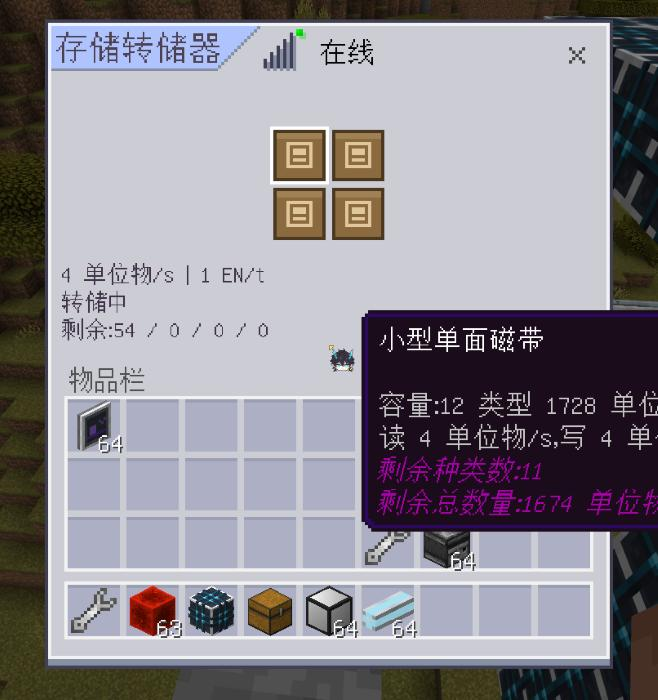
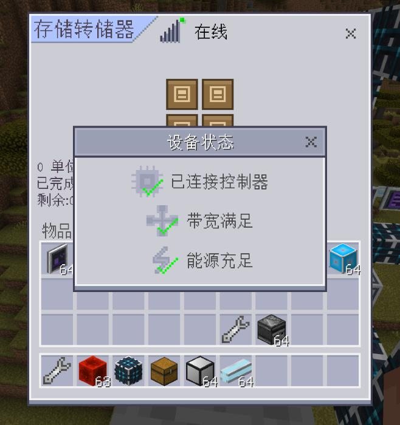

# 存储转储器验收（2026-11-13）

## 交付

`endernet:storage_transfer`：四槽非空介质向网络搬运物品和流体，源不挂为公共库存，固定 1u，仅小型控制器支持；最近一秒实际成功量合计后按 `floor(单位物/s / 4)` 计 EN/t。

共享介质唯一身份、容量 Lore、成对内存提交与关联保存组。关联组暂存中途失败时禁止仓库提交，完整重试后恢复。原生 2×2 容器界面、状态详情、动态工作摘要、正面贴图和朝向已接入。

## 离线

- `python -B endernet_tests/run_tests.py`：**4776 项全部通过，171 个运行时文件通过 Python 2.7 语法门禁**。原始结果：[offline-tests.txt](offline-tests.txt)。
- 新增 `test_storage_transfer.py` 18 项，覆盖四槽/多设备公平性、源不计库存、物品/流体守恒、限速、满类型跳过、多个目标轮询、滚动计费、离线清窗、未清空抽取、重复身份、拆除失效、异常回滚、关联保存失败重试、重进恢复、真实漏斗 typed NBT。
- `python -B scripts/gen_blocks.py --check`：33 个方块定义及资源映射一致。
- `python -B scripts/gen_device_textures.py --check`：设备贴图齐全。
- `git diff --check`：通过。环境未安装额外的 Ruff 命令，未声称运行 Ruff 检查。

## 游戏实测

通过当前 EnderNet MCDK 会话，使用独立小型控制器、8 位基带、四盘驱动器及创造能量源测试。

| 场景 | 实际结果 |
| --- | --- |
| 放置、连接、打开 | `(1,90,-15)` 为四槽设备，在线，原生 `endernet_storage_transfer.main` 打开成功。 |
| 四槽混合搬运 | 512 石头、256 泥土、128 圆石、5000 mB 水全部转入目标；目标 49800 微单位物，四源介质变空；源 ID 不在网络 mounted 中。 |
| 空介质及非空介质物流插入 | 上方原版漏斗反复插入空介质被拒。修正事件 typed NBT 归一化后，带 256 钻石的 `medium:25` 能正常进入并开始搬运。 |
| 提前物流抽取 | 下方原版漏斗抽走 `medium:25`，当时仍有 7350 微单位物（147 钻石）；随后内容保持不变，源槽清空，旧任务停止。 |
| DOS 限制 | 替换主控为 DOS 后设备离线，原因为 `controller_does_not_serve`，7350 微单位物不变；恢复小型主控后继续搬运。 |
| 断电与恢复 | 去掉创造能量源后，源中 512 红石（25600 微单位物）不变，耗能窗口归零；恢复电源后继续，实测摘要 4 单位物/s、1 EN/t。 |
| 保存重进 | 断电后源剩 9100 微单位物，源与目标合计 88200；完整重进后两个数值完全一致，恢复供电继续转储。 |
| 清空与界面 | 完成后保留介质，显示已完成；总耗能归零。在线栏可点击打开控制器、带宽、能源详情，再关闭。 |
| 拆除掉落 | 给测试源保留 7 金锭后调用真实玩家破坏接口，设备状态被移除；实际掉落实体仍携带 `medium:25`，数量 1，Lore 剩余 1721 单位物，权威内容保留 350 微单位物。 |

完整重进后的验收均无 tick 错误。开发期间曾在给调度器新增字段后使用原地热重载，旧实例缺字段；按工具要求改为完整重进世界解决，没有加入掩盖旧实例问题的运行时兜底。

实测后在 `(1,90,-15)` 恢复了一台在线的空槽转储器，独立测试网络保留以便继续试用；临时上下漏斗及站立平台已移除，玩家位置恢复到测试前。

## 视觉证据与限制

静态 JSON UI 渲染完成；原生实机确认布局、中文标题、四槽、速度/耗能/剩余量和状态详情。实机截图上的人物图案来自环境现有 HUD，不属于新设备控件。

触屏与手柄沿用原生容器输入，未在对应硬件上实测；自定义第三方物流接口未逐个模组测试。存档保证沿用现有 ExtraData 提交边界，不额外承诺引擎进程异常终止时最后未提交帧的落盘。
