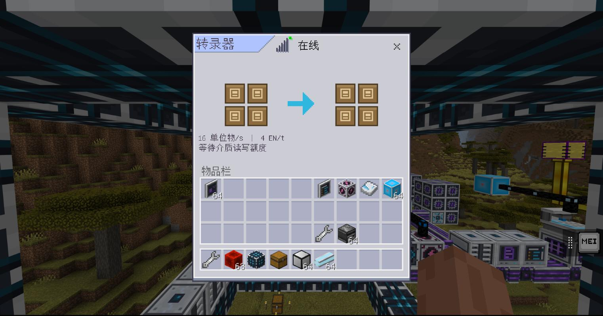

# 转录器交付记录（2026-11-13）

## 已实现

`endernet:transcriber`：左四槽向右四槽合并转移物品/流体；DOS 与小型控制器均支持；0u 带宽；按可执行单位物/s 的四分之一向下取整计 EN/t。无需按钮、界面关闭仍运行，供能不足暂停，不自动降速。

设备分类不注册 storage_provider，网络存储服务不挂载其介质。`MediumBayStore` 提供共用介质身份、读写桶、真实容器归属、载体恢复、重复 ID 检测和持久化；`StorageDriverStore` 保留兼容入口。没有新槽位存档，也没有复制介质内容或改变既有载体格式。

`TranscriberService.prepare` 在能源结算前用一秒额定额度的独立副本报价；`execute` 在网络推进后复核真实槽位与代次，再成对提交。正常额度积累显示“正在转写”，不每几帧闪烁业务状态。模拟不动真实库存/额度；失败恢复两侧条目、容量计数、版本和桶状态。按成功转移轮换，整件物品等待额度时不让流体吃掉余量。

`EnergySpec.dynamic` 与 `EnergyService.set_dynamic_demand(ref, demand)` 接入服务端权威需求，支持拓扑重挂和代次校验；普通工作态更新不能覆盖动态报价。供能不足仍保留报价，避免停机和归零反复循环。

关联介质通过成组暂存避免被帧预算分拆；暂存失败整组留脏并阻止不完整组提交，恢复后重试。沿用现有世界 ExtraData 持久性边界，不承诺异常断电的最后一帧事务。持续转移的 Lore 保留首次待刷新时间，按预算合并刷新；玩家/漏斗取出和破坏前刷新交接内容。

## 离线验证

新增 `endernet_tests/test_transcriber.py`，覆盖合并吞吐、读写瓶颈、类型/容量不足、部分转移、混合流体公平性、低速余数、模拟无副作用、成对提交失败回滚、动态能源、断电稳定需求、拔盘/卸载、跨设备重复 ID 和移盘、损坏/型号不符、保存恢复及成组保存故障、持续 Lore 刷新。组合根用例验证两种控制器都能运行，同时公共库存保持为空、带宽占用为 0。

最终检查：`python -B endernet_tests/run_tests.py` 通过 **4774 项测试**，171 个运行时源码文件通过 Python 2.7 语法门禁；其中转录器专用测试 25 项。`python -B scripts/gen_blocks.py --check` 通过（当前工作区共 33 个方块），`git diff --ignore-submodules --check` 通过。结果包含同工作区并行完成的存储转储器变更。

## 游戏验证

通过项目 MCDK 连接，使用独立临时网络及测试介质验证：

- 真实八槽容器、左右各 2×2、箭头、中文标题、在线状态、速度/耗能摘要正常显示。四张磁带显示 16 单位物/s、4 EN/t。
- 首轮来源四张各 100 石头，最终来源全部 0，目标合计 400，网络公共库存挂载列表为空。
- 重新进入世界后介质 ID 9～16 及 400 石头完整保留。
- 桌面鼠标取出来源介质到背包，ID 保持不变，空盘 Lore 为剩余 12 类型、1728 单位物；随后放回。
- 移除测试电源后来源各 100、目标 300/302/299/299 保持不变，设备离线，报价仍是 16 单位物/s、4 EN/t；恢复电源后自动转完，目标 400/402/399/399，共 1600，空闲耗能归零。
- 上方漏斗尝试向空槽输入石头：目标槽保持空，石头仍在漏斗，服务端拒收计数增加。
- 引擎破坏测试设备后恰好掉出 8 件介质，每件数量 1，ID 与拆前一致；权威内容仍为四张空盘和合计 1600 石头。
- 临时方块、漏斗、测试石头及八件测试掉落物已清理。

桌面截图：

## 验证边界

- 触屏实机交互尚未验证；复用原生容器控件，未新增自定义触屏键位。
- 玩家拖入非法物品的独立桌面操作用例受另一聊天同时操作同一窗口影响，未作为通过项；拒收规则离线测试与真实漏斗路径已验证。
- 高并发规模/性能压测未进行；继承仓库尚未定案的介质策略和时钟参数。
- 原有工作区改动及同时进行的存储转储器工作均保留，本次没有修改 ToolDelta 子模块、创建提交或变更合成配方。
